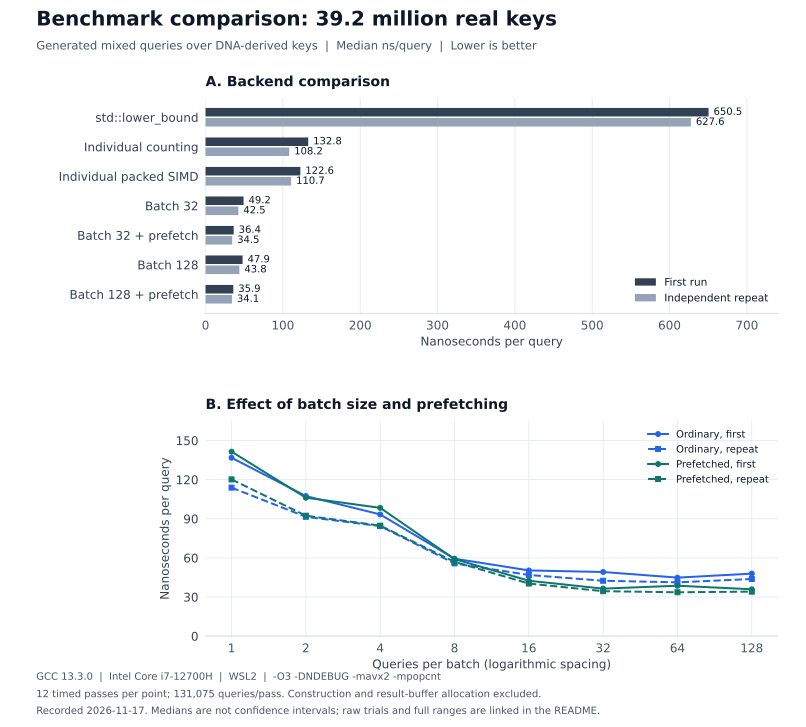
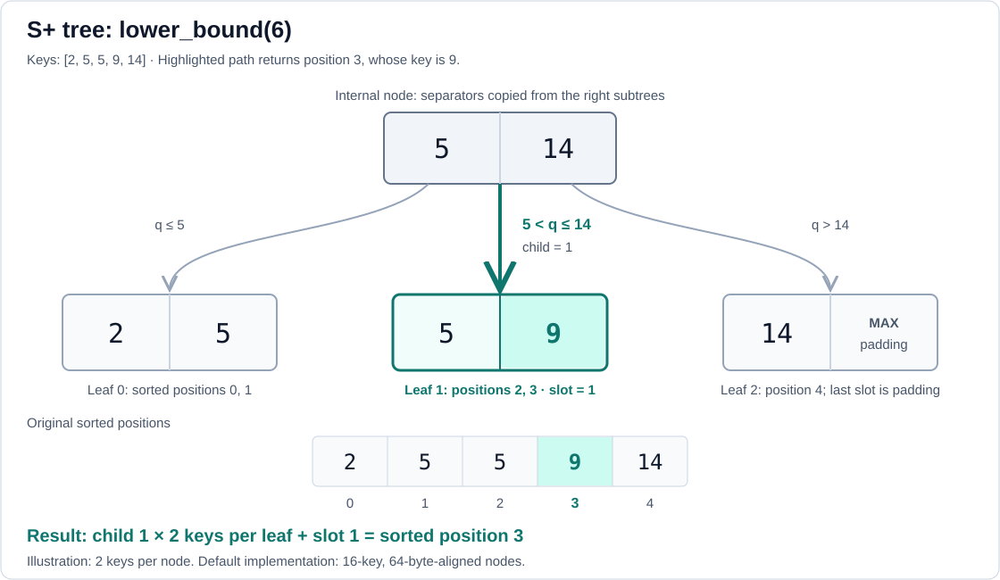

# StaticSearchTree

A header-only C++20 index for lower-bound searches over static, sorted
`std::uint32_t` keys. It supports individual and batched queries
through a small public interface.

- Copy one self-contained header: [stree.hpp](include/stree.hpp).
- Preserve the first occurrence of duplicate keys and support the full unsigned
  32-bit range.
- Own the indexed keys; the source does not need to outlive the index.
- Use either allocated batch results or reusable caller-owned output buffers.
- Integrate directly or through the optional CMake interface target.

[Benchmarks](#benchmark-results) · [Quick start](#quick-start) · [S+ tree](#how-the-s-tree-works) · [API](#public-api) · [CMake](#cmake-integration)

## Benchmark results

The table below reports **median nanoseconds per query** for 39,159,057 keys
encoded from the hg38 chromosome 22 reference sequence. Lower is better.
Queries alternate sampled existing keys and uniformly generated 32-bit probes.
These are throughput measurements over batches of independent queries, not
individual request-response latency.



The upper panel compares backends; the lower panel shows batch-size effects.
Solid lines in the lower panel are the first run, and dashed lines are the
independent repeat. The plot shows medians, not full trial ranges or confidence
intervals; exact values and raw-trial links follow.

| Backend | First run, ns/query | Independent repeat, ns/query |
| --- | ---: | ---: |
| `std::lower_bound` | 650.495 | 627.643 |
| Individual counting | 132.776 | 108.220 |
| Individual packed SIMD | 122.623 | 110.664 |
| Batch 32 | 49.169 | 42.459 |
| Batch 32 with prefetch | 36.415 | 34.453 |
| Batch 128 | 47.931 | 43.799 |
| Batch 128 with prefetch | 35.917 | 34.121 |

**Recorded:** 2026-11-17. **Environment:** Intel Core i7-12700H under WSL2, GCC 13.3.0, C++20,
`-O3 -DNDEBUG -mavx2 -mpopcnt`. Each method used 131,075 queries per pass,
one warm-up, and twelve measured trials. Method order was shuffled per trial;
every output was checked against a reference after timing.

Prefetching reduced batch-32 query time by **25.9%** in the first run and
**18.9%** in the repeat. Results vary with workload: on a 1,024-key uniform
mixed-query case, batch 32 increased from 6.606 to 7.200 ns/query with prefetch.
Nearby batch sizes can have overlapping timing ranges; no universal winner is
implied.

These measurements time explicitly selected backends with caller-provided
output. The eligible accelerated public batch API selects the prefetched
batch-32 backend, but the table does not directly measure its wrapper or the
allocating convenience overload. Input preparation, sorting, construction,
and validation are excluded. The full real-data index allocated **158.72 MiB**,
approximately **6.25%** above its sorted key storage; caller buffers are separate.

Read the [complete benchmark report](docs/batch-prefetch-results.md),
[first-run raw results](benchmarks/batch_prefetch_avx2_real.csv),
[repeat raw results](benchmarks/batch_prefetch_avx2_repeat_real.csv), and
[dataset manifest](benchmarks/real_dataset.json) for trials, ranges, provenance,
and limitations. Measure the public interface with your own workload before
choosing build options.

## Requirements

- A compiler with C++20 support.
- CMake 3.21 or newer for CMake integration and CTest.
- Compatible hardware when compiling with instruction-set-specific options.

The library has no third-party runtime dependencies and does not require a
separately compiled library.

## Quick start

Copy `include/stree.hpp` beside your source file and save this as `main.cpp`:

```cpp
#include "stree.hpp"

#include <array>
#include <cstddef>
#include <cstdint>
#include <iostream>
#include <vector>

int main()
{
    const sst::StaticSearchTree tree({2, 5, 5, 9, 14});

    const auto index = tree.lower_bound(6);
    if (index != tree.size()) {
        std::cout << index << '\n'; // 3: the first qualifying key is 9
    }

    const std::array<std::uint32_t, 4> queries{6, 5, 20, 0};
    const auto positions = tree.lower_bound_batch(queries);
    for (const auto position : positions) {
        std::cout << position << ' ';
    }
    std::cout << '\n';
}
```

Compile and run with GCC:

```bash
g++ -std=c++20 -O3 main.cpp -o example
./example
```

Output:

```text
3
3 1 5 0
```

## Search semantics

A result is a `std::size_t` position in the original construction input,
selecting the **first key greater than or equal to the query**. It is a
lower-bound position, not a key value, boolean, or guaranteed exact match.

For keys `[2, 5, 5, 9, 14]`:

| Query | Position | Meaning |
| --- | ---: | --- |
| `0` | `0` | The first qualifying key is `2`. |
| `5` | `1` | Selects the first duplicate. |
| `6` | `3` | The first qualifying key is `9`. |
| `20` | `5` | No qualifying key exists. |

`tree.size()` is the past-the-end result and must not be dereferenced. For an
empty index, every query returns zero, which also equals its size.
`UINT32_MAX` is a valid key and query; it is not a missing-result marker.
Batch results preserve query order, and queries do not need to be sorted.

## How the S+ tree works

All input keys are stored in sorted leaf nodes. Internal nodes contain
separators copied from their child subtrees, allowing a search to select a
child without following individually allocated node pointers. The default
layout holds 16 keys per 64-byte-aligned node and has up to 17 children.



The illustration uses two keys per node to make the traversal visible:

1. **Select a child.** Count the current node's separators smaller than the
   query. At the root `[5, 14]`, query `6` has one smaller separator, so it
   selects child `1`.
2. **Repeat at each level.** Each query keeps a node position local to its
   current level. The next position is `node * (keys_per_node + 1) + child`.
3. **Search the leaf.** Leaf `1` contains `[5, 9]`. Its first key at least `6`
   is at slot `1`.
4. **Return the sorted position.** With two keys per leaf, the result is
   `1 * 2 + 1 = 3`, whose original key is `9`.

Each separator is the minimum of the subtree to its right. Equality routes
left so duplicate keys still resolve to their first occurrence. If the search
reaches the end of a leaf, its computed position can advance into the next
leaf. Results are clamped to the logical input size, keeping padding out of
returned valid positions.

Nodes are stored in contiguous levels, with offsets identifying each level.
The optimized backends compare node keys using SIMD. Batching advances
independent queries level by level; prefetching requests their selected next
nodes while other queries are processed. See the [tree design](docs/stree-design.md),
[batch traversal](docs/stree-batching.md), and
[prefetch explanation](docs/stree-batch-prefetch.md) for implementation details.

## Public API

| Operation | Result |
| --- | --- |
| `sst::StaticSearchTree tree(sorted_keys)` | Constructs an owning index. |
| `sst::StaticSearchTree tree` | Constructs an empty index. |
| `tree.lower_bound(query)` | Returns one position; does not allocate and is `noexcept`. |
| `tree.lower_bound_batch(queries)` | Returns `std::vector<std::size_t>`, allocating output storage. |
| `tree.lower_bound_batch(queries, output)` | Fills caller-owned output without heap allocation. |
| `tree.size()` | Returns the number of indexed keys. |
| `tree.empty()` | Reports whether the index contains no keys. |
| `tree.storage_bytes()` | Returns index-owned allocated capacity in bytes. |

Construction accepts vectors, `std::array`, C arrays, const spans, and
initializer lists of `std::uint32_t`. Input must be sorted in nondecreasing
order. Unsorted keys throw `std::invalid_argument`; the library does not sort
them automatically.

The index copies its input and supports copy and move operations. Updating keys
requires constructing a new index. `storage_bytes()` excludes caller-owned
buffers and temporary construction storage. Allocation and size errors from
standard containers propagate normally.

### Reusing batch output

For repeated searches, allocate the output buffer once:

```cpp
std::vector<std::size_t> output(queries.size());
tree.lower_bound_batch(queries, output);
```

The buffer overload accepts spans, vectors, or arrays with `std::uint32_t`
query elements and `std::size_t` output elements. Query and output lengths must
match; otherwise it throws `std::invalid_argument` before writing any output.
Their storage must not overlap. Empty queries produce no answers.

An index may be shared across concurrent read-only searches. Keep query storage
valid for each call and use independent output buffers.

## CMake integration

Place this repository at `external/static-search-tree-cpp` in your application:

```cmake
cmake_minimum_required(VERSION 3.21)
project(search_example LANGUAGES CXX)

add_subdirectory(external/static-search-tree-cpp)
add_executable(search_example main.cpp)
target_link_libraries(search_example PRIVATE sst::static_search_tree)
```

The `sst::static_search_tree` interface target supplies the include directory
and C++20 requirement. It produces no library binary. Tests and examples are
not built by default when this project is added as a dependency.

To build this repository's example and portable tests:

```bash
cmake -S . -B build -DCMAKE_BUILD_TYPE=Release
cmake --build build --config Release --parallel 2
ctest --test-dir build -C Release --output-on-failure --no-tests=error
```

| CMake option | Default | Purpose |
| --- | --- | --- |
| `BUILD_TESTING` | `ON` for the top-level project | Registers the correctness tests. |
| `SST_BUILD_EXAMPLES` | `ON` for the top-level project | Builds `sst_example`. |
| `SST_TEST_AVX2` | `OFF` | Adds accelerated/control tests after a supported host capability check. |
| `SST_ENABLE_SANITIZERS` | `OFF` | Instruments project executables with ASan/UBSan on supported GCC/Clang builds. |

For a library-only top-level configuration, set
`-DBUILD_TESTING=OFF -DSST_BUILD_EXAMPLES=OFF`.

## Optimization and portability

The public interface chooses its implementation at compile time. Individual
queries use counting. Generic batches also use counting; eligible x86 builds
with AVX2 and POPCNT enabled use prefetched groups of 32 with individual tail
handling. Callers do not need algorithm names or batch-size template arguments.

An optional targeted GCC/Clang build is:

```bash
g++ -std=c++20 -O3 -mavx2 -mpopcnt main.cpp -o example
```

There is **no runtime CPU dispatch**. An executable requires the instruction
sets enabled by its build flags. Use consistent target flags and selection
macros across translation units. `SST_DISABLE_MASK_SIMD` selects the counting
batch fallback, and `SST_DISABLE_PREFETCH` removes explicit prefetch hints.

Defaults are conservative choices, not a guarantee of the fastest method on
every workload. The advanced `sst::STree` interface remains available for
explicit tuning; see the [search design](docs/stree-design.md).

## Testing and CI

The [CI workflow](.github/workflows/ci.yml) is configured for Linux GCC, Linux
Clang, Windows MSVC, and a separate Linux GCC sanitizer job. Checks cover the
public API, boundary values, duplicates, batch tails, ownership, concurrent
reads, copied-header consumption, and a separate CMake consumer project.
CI uses generated fixtures and does not require external datasets.

Local GCC, Clang, and ASan/UBSan results, hosted-run limitations, and commands
are recorded in the [CI validation record](docs/ci-validation.txt). See the
[CI guide](docs/ci.md) for configuration details and the
[API validation report](docs/simple-api.md) for interface coverage.

## Reproducing benchmarks

The C++ benchmark executables check search outputs against a reference outside
the timed region. Reports retain raw trials, workload definitions, construction
observations, and index allocation sizes:

- [Workload validation](docs/workload-results.md)
- [Batch-size comparison](docs/batch-results.md)
- [Batched prefetch comparison](docs/batch-prefetch-results.md)
- [Benchmark commands and input requirements](benchmarks/README.md)

Real-data runs require the prepared `data/chr22.u32` file matching the
[dataset manifest](benchmarks/real_dataset.json). Large datasets are not stored
in the repository. With that file available, run:

```bash
bash tools/run_batch_prefetch_benchmarks.sh
```

The measurements use genuine DNA-derived keys with generated probes, rather
than captured application traffic. They do not establish end-to-end application
performance or include allocating-convenience overhead.

## Documentation

- [Behavior and ownership contract](docs/contract.md)
- [Public API details](docs/simple-api.md)
- [Tree layout](docs/stree-design.md)
- [Batch traversal](docs/stree-batching.md)
- [Prefetch behavior](docs/stree-batch-prefetch.md)
- [CMake and CI walkthrough](docs/ci.md)
