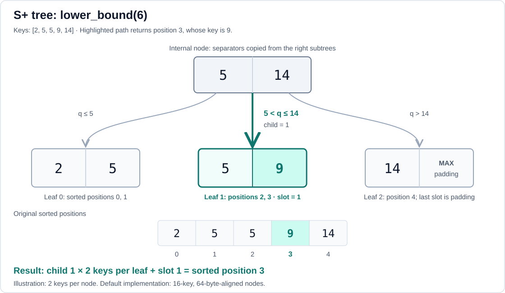

# Design

## Layout and construction

`StaticSearchTree` owns an `STree<16>`. Each node occupies one aligned 64-byte
cache line and holds 16 unsigned 32-bit keys. Internal nodes have up to 17
children; all original keys live in sorted leaf order. Levels are packed into
one vector with a small array of level offsets, avoiding child pointers.

Construction validates sorted input, counts levels from the leaves upward,
allocates initialized nodes, copies the keys, and builds separators bottom-up.
Separator j is the minimum of child j+1. Missing slots contain `UINT32_MAX`.
Ceiling division and total-size checks avoid arithmetic overflow before allocation.
Large indexes use roughly 6.25% more node storage than their input key array.

For a position local to a level, traversal computes:

```cpp
position = position * (KeysPerNode + 1) + child;
```

Equality routes left, preserving the first duplicate even when equal runs cross
subtrees. At a leaf, `position * KeysPerNode + slot` gives the original sorted
index. A slot equal to the node width intentionally spills to the following
leaf. Clamping to the logical size keeps padding out of valid answers.
`UINT32_MAX` remains a real key because absence is represented by `size()`.

`key_at(i)` reads directly from the leaf array after checking the logical bounds.
It needs no duplicate copy of the keys. `contains(q)` checks the lower-bound key.



## Node search

The advanced `STree<KeysPerNode>` interface retains explicit backend methods for
benchmarking and tuning. A single templated traversal calls the selected node
search, avoiding duplicated navigation logic and runtime dispatch:

| Method | Node operation |
| --- | --- |
| `lower_bound` | Early-exit linear scan. |
| `lower_bound_count` | Count keys strictly below the query; permits auto-vectorization. |
| `lower_bound_mask` | Ordered comparison bits followed by trailing-zero count. |
| `lower_bound_popcount` | One comparison bit per smaller key, followed by population count. |
| `lower_bound_packed` | Packed comparison words, one byte mask, population count divided by two. |

The explicit AVX2 paths apply to 16-key nodes. Packed/popcount search flips the
sign bit of both keys and query so signed SIMD comparison preserves unsigned
ordering. Packing zero/-1 lanes into signed 16-bit words preserves comparisons;
each true word yields two byte-sign bits. Packing permutes lanes, but their
population count is unchanged. Mask search preserves lane order and adds an
end marker so an empty match mask returns the node width.

Generic targets and other widths use portable helpers. `SST_DISABLE_MASK_SIMD`
disables the explicit SIMD backends. This does not disable compiler vectorization.
The GCC counting loop suppresses early unrolling so the vectorizer sees a reduction.

## Batches and prefetch

Each query has its own node position. Batching advances all queries at one level
before moving to the next, exposing independent memory requests. The prefetched
variant issues a read hint for the selected next node while other queries run.
The target index is checked before forming the pointer. Hints use GCC/Clang's
builtin; `SST_DISABLE_PREFETCH` removes them.

Fixed arrays return fixed arrays. Span overloads copy complete groups to the
fixed-size core and use individual packed searches for the tail. Neither path
allocates heap storage. Span lengths are checked before writing; non-overlapping
valid input/output storage is the caller's responsibility.

The public facade uses counting for individual queries and generic batches.
Builds with AVX2 and POPCNT use prefetched batches of 32. The allocating overload
adds only its output vector. These defaults depend on compile-time flags.

## Tests and baselines

Tests compare results with `std::lower_bound` and check predecessor/successor
bounds. They cover duplicates, unsigned limits, tree-height transitions, node
widths 1–16, batch tails, rejected lengths, ownership, key access, and concurrent
reads. CMake also checks copied-header use and a separate consumer project.

Binary search and Eytzinger live under `benchmarks/baselines/`, outside the public
include directory. Eytzinger uses a breadth-first binary tree with aligned keys,
four-level prefetching, and a sorted-position map. Its map costs additional memory,
which the benchmark reports along with construction time. Benchmark runners
validate every answer outside the timer and write generated results to `results/`.
